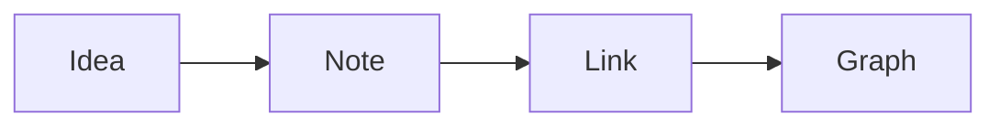

# Formatting Reference

A note that shows every Markdown element Loam displays. It is all standard Markdown (CommonMark + GFM): the file stays readable in any editor.

## Headings

### Heading 3
#### Heading 4

## Emphasis

*italic*, **bold**, ***bold and italic***, ~~strikethrough~~, ==highlighted==, `inline code` and \*escaped asterisks\*.

## Lists

- Bullet list
  - Sub-item
    - Sub-sub-item
1. Numbered list
2. Second step
   1. Sub-step

## Tasks

- [ ] A task to do 📅 2026-11-14 ⏫ #example
- [x] A finished task ✅ 2026-10-29

## Quote

> A one-line quote.
>> A nested quote.

## Table

| Left | Center | Right |
|:-----|:------:|------:|
| Text | ok | 42 |
| Other | ok | 1,250 |

## Code

```swift
struct Note: Identifiable {
    let id: UUID
    var title: String
}
```

```bash
loam tasks.list done=false
```

## Diagram



## Links

- Markdown link: [Markdown, Wikipedia](https://en.wikipedia.org/wiki/Markdown)
- Automatic link: <https://commonmark.org>
- Link to a note: [[Home]]
- Link to a note with another label: [[Home|back to the home page]]

## Tags

#example · #project/sub-tag · #travel

## Image


## Separator

---

## Properties

Properties sit at the top of a note, between two `---` lines:

```yaml
---
tags: [example]
date: 2026-10-29
status: To do
---
```
