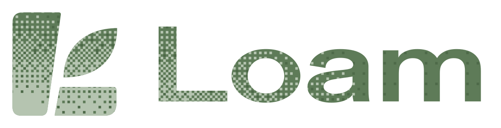
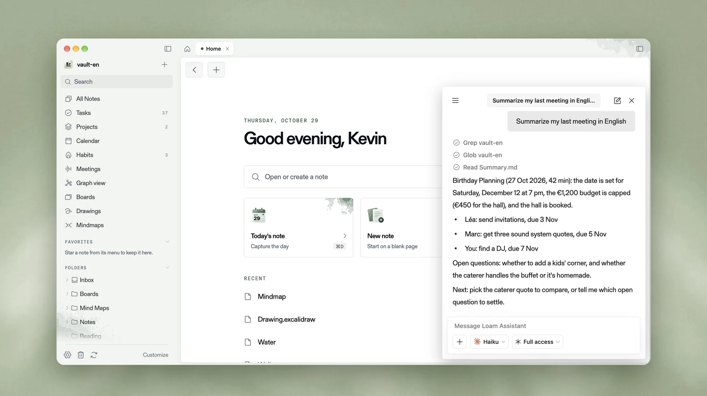
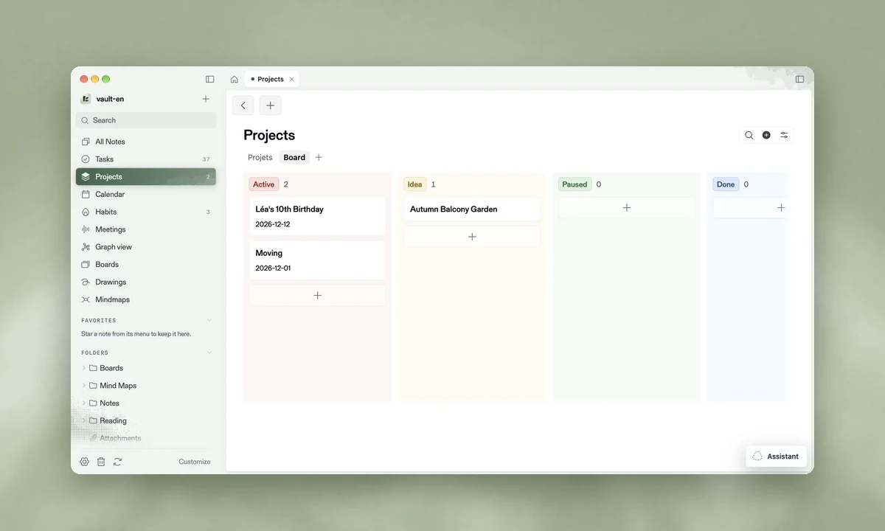
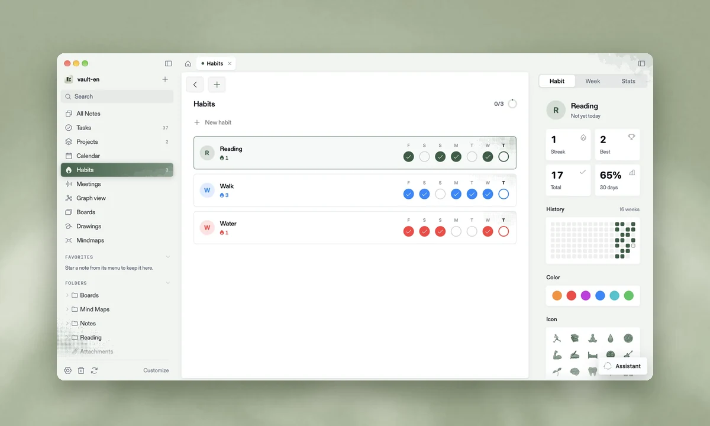
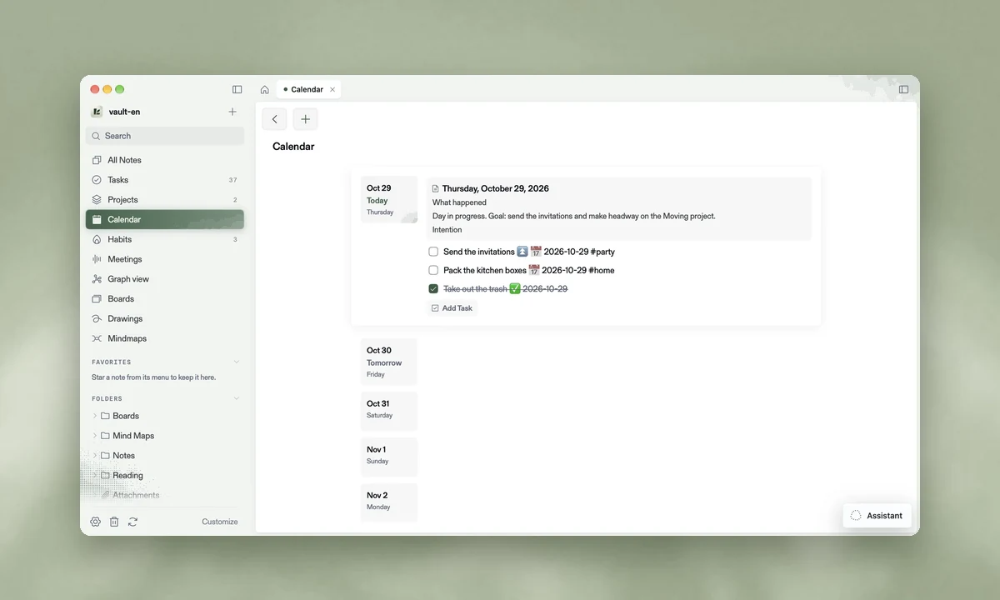
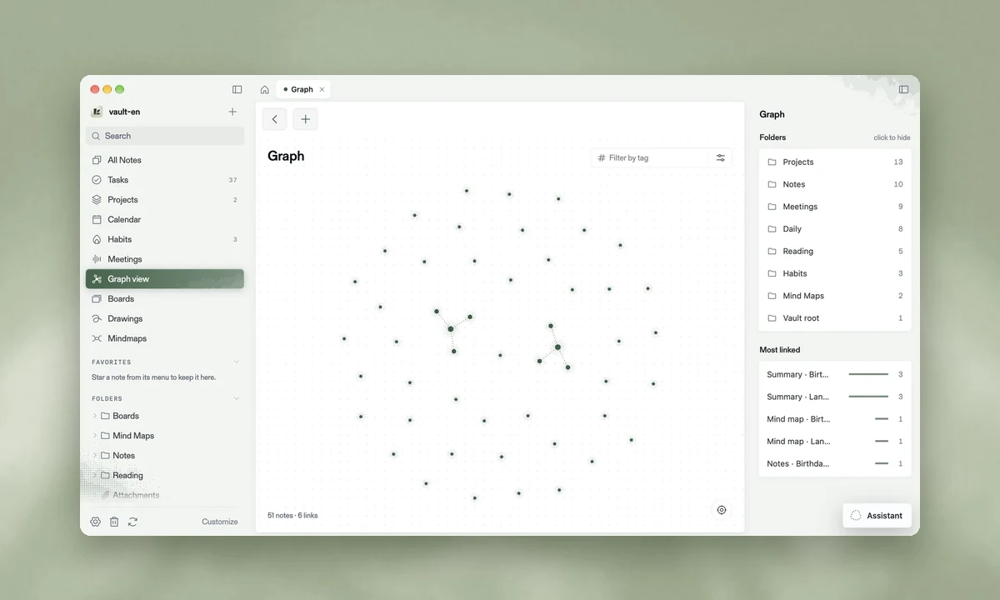
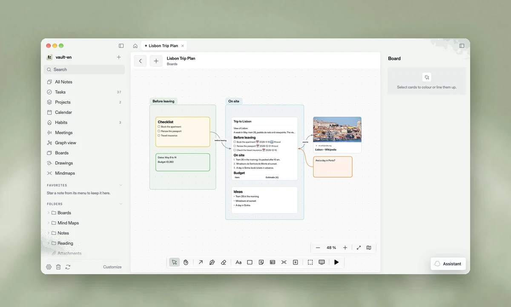
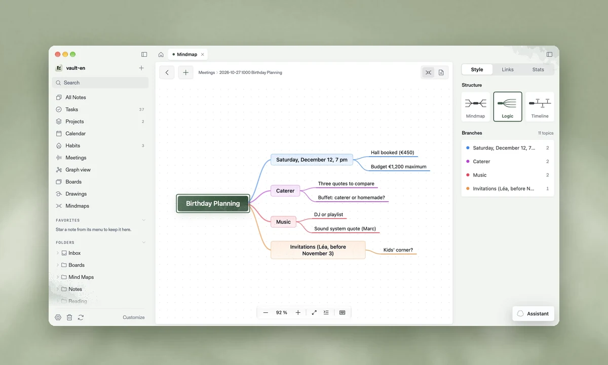
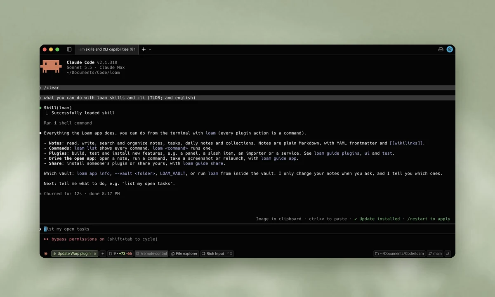
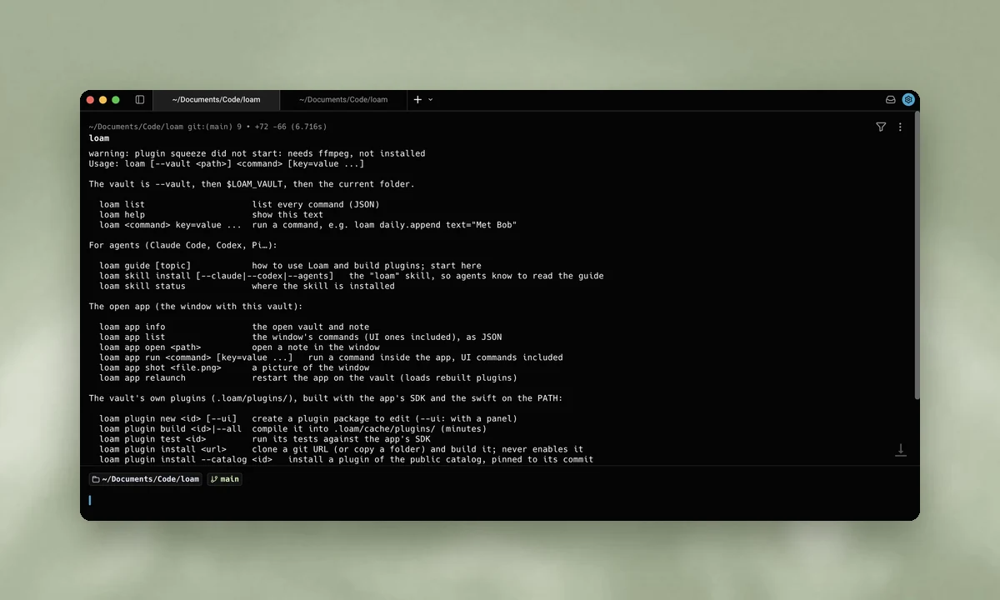

<div align="center">

<picture>
  <source media="(prefers-color-scheme: dark)" srcset="docs/readme/logo-dark.svg">
  
</picture>

### The second brain that becomes whatever you need.

Loam is a free Mac app where notes, projects, mind maps and meetings live as plain Markdown.<br>
Every feature is a plugin anyone can write: you, the community or your AI agent.

[**Website**](https://loam.md) · [**Download**](https://loam.md) · [**Docs**](https://loam.md/docs) · [**Write a plugin**](docs/WRITING-PLUGINS.md)


[](https://github.com/Azilone/loam/stargazers)

<br>



</div>

<br>

## Why Loam

Simple note apps are a joy until the day you need a board, a mind map or a habit tracker. Powerful ones can do
anything, but they are heavy, and they keep your notes in their format or their cloud.

Loam keeps both promises:

- **Simple by default.** Open it and write. You never see a feature you did not ask for.
- **Everything else is a plugin.** Tasks, calendar, boards, mind maps, habits, meetings, graph: all bricks
  you can add, change, remove or share.
- **Capture in one keystroke.** Copy a link, a picture or a PDF, press ⌃⌥Space in any app. Loam saves it to
  `Saved for later`, then your agent adds a title, a summary, tags and links to related notes.
- **Your agent builds what is missing.** Describe the feature to Claude Code, Codex or any agent. It writes the
  plugin, tests it and reloads the app.
- **Your notes stay yours.** Plain Markdown files in a folder on your disk. Readable forever, by any tool, with
  or without us.
- **Native and fast.** Built in Swift for macOS. No Electron, no account, no cloud required.

<br>

## One notebook, many tools

<table>
  <tr>
    <td width="50%" valign="top">
      
      <p align="center"><b>Projects</b><br><sub>Every project on a board, from idea to done.</sub></p>
    </td>
    <td width="50%" valign="top">
      
      <p align="center"><b>Habits</b><br><sub>Streaks, history and stats at a glance.</sub></p>
    </td>
  </tr>
  <tr>
    <td width="50%" valign="top">
      
      <p align="center"><b>Calendar &amp; daily notes</b><br><sub>Your days, your tasks and their due dates in one view.</sub></p>
    </td>
    <td width="50%" valign="top">
      
      <p align="center"><b>Graph</b><br><sub>See how your notes connect through links.</sub></p>
    </td>
  </tr>
  <tr>
    <td width="50%" valign="top">
      
      <p align="center"><b>Boards</b><br><sub>An infinite canvas for plans, links and cards.</sub></p>
    </td>
    <td width="50%" valign="top">
      
      <p align="center"><b>Mind maps</b><br><sub>Map out an idea, branch by branch.</sub></p>
    </td>
  </tr>
</table>

<br>

## Built for builders and their agents

Loam ships with a command line and an agent skill. Your agent can read and write your notes, drive the open app
and build new plugins on its own.

<table>
  <tr>
    <td width="50%" valign="top">
      
      <p align="center"><b>Agent skill</b><br><sub><code>loam skill install --claude</code>, and your agent knows Loam.</sub></p>
    </td>
    <td width="50%" valign="top">
      
      <p align="center"><b>CLI</b><br><sub>Every app action is a command: <code>loam list</code>.</sub></p>
    </td>
  </tr>
</table>

```bash
loam daily.append text="Met Bob"       # write to today's note
loam capture.add url="https://…"       # save a link, your agent sorts it
loam app open "Projects/Moving.md"     # open a note in the app
loam plugin new habits-plus --ui       # start a plugin with a panel
loam plugin build habits-plus          # compile it into the vault
loam plugin test habits-plus           # run its tests against the SDK
```

<br>

## Install

Loam runs on Macs with Apple silicon and macOS 26 or later.

```bash
curl -fsSL https://raw.githubusercontent.com/Azilone/loam-releases/main/install.sh | bash
```

The installer script is in the loam-releases repository, not in this one. Loam links the `loam` command into
`~/.local/bin` and checks each update's SHA-256 and signature. After that, Loam updates itself.

Prefer your agent to do it? Paste this into Claude Code, Codex or any agent:

```text
Use curl to read https://loam.md/agents.md and perform the setup to install Loam
```

<br>

## Write a plugin

A plugin is a small Swift package that lives in your vault, in `.loam/plugins/`. It can add a panel, a slash
command, an importer or a background service.

```bash
loam plugin new my-plugin --ui
```

Then open [docs/WRITING-PLUGINS.md](docs/WRITING-PLUGINS.md), or simply ask your agent: *"Build me a Loam plugin
that…"*.

<br>

## Build from source

```bash
git clone https://github.com/Azilone/loam.git
cd loam
make test-vault   # a demo vault to try the app on, never your real notes
make run          # build and open Loam on it
make test-fast    # the tests your changes reach (~1 min)
```

Start with [docs/VISION.md](docs/VISION.md) and [docs/ARCHITECTURE.md](docs/ARCHITECTURE.md).

<br>

## Contributing

Bugs, ideas and plugins are welcome. Read [CONTRIBUTING.md](CONTRIBUTING.md), then open an issue or a pull
request. Security reports follow [SECURITY.md](SECURITY.md).

If Loam is useful to you, a star on GitHub helps other people find it.

<br>

## License

[MIT](LICENSE) © 2026 The Loam authors. Third-party notices are in [THIRD_PARTY_NOTICES.md](THIRD_PARTY_NOTICES.md).
