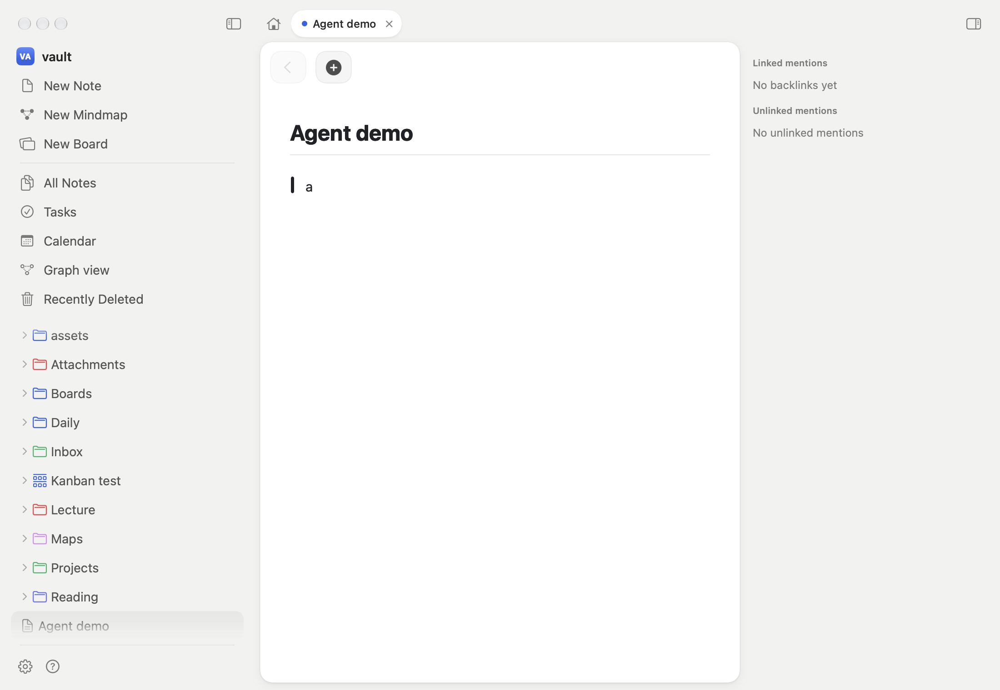

# Agent test bench

How an agent checks Loam's UI without the screen, the keyboard focus or a human: an **isolated instance** of the
app, driven through a **debug socket** by `scripts/loam-ctl`. Several agents run side by side; nothing is shared but
the machine. How to use it for a UI change: the `ui-verify` skill.

_`scripts/agent-demo.sh`: a note opened, `> a`, Return, Return, the window captured: the picture above._

## What it is

- **Instance** (`scripts/agent-run.sh NAME`, or `make run INSTANCE=NAME`): builds the app, copies it to
  `/tmp/loam-instances/NAME/Loam.app` with its own bundle id (`com.azilone.loam.agent.NAME`: own preferences, own
  window restoration), window title `Loam [NAME]`, a vault copied from a template (`~/TestVault` by default), and
  its own socket `ctl.sock`. It starts in the background and never takes the focus. Starting a name again restarts it.
- **Debug channel** (`App/Sources/NotebookApp/Debug`, protocol in `App/Sources/DebugProtocol`): a Unix socket
  speaking one JSON line per request and per response. It is compiled into debug builds only, or into a release build
  made with `-DLOAM_AGENT_BRIDGE` (`agent-run.sh --release`); a normal release build has no trace of it
  (`AgentInstance.isCompiledIn`). It listens only when `LOAM_INSTANCE` or `--instance` is set. The socket is mode
  0600 in a 0700 folder.
- **`scripts/loam-ctl`**: the client (Python 3 standard library). `loam-ctl --help` lists every command.

Events are handed to this process's own event dispatch (`NSApp.sendEvent`), and pictures are drawn from the views:
no Accessibility or Screen Recording permission, no `computer-use`, and it works with the app in the background,
its window hidden or the screen locked.

## Commands

Targets are `X,Y` (points from the window content's top-left corner, so a 2200 px wide screenshot is 1100 points
wide), `id:IDENTIFIER` or `label:TEXT` (an accessibility element; `ax --find` lists them with their frames).

| Command | Does |
| --- | --- |
| `open PATH` | opens a note, folder or `scheme:page` of the vault (`--new-tab`, `--beside`) |
| `type TEXT`, `key cmd+n` | key presses, as the keyboard sends them (`\n` is Return) |
| `click`, `hover`, `drag`, `press`/`move`/`release`, `scroll` | the pointer; hover reaches SwiftUI's `.onHover`; `click` and `scroll` take `--window settings` |
| `window W H [--front] [--live N]` | content size in points; `--live` drags the right edge to `W` over N frames (AppKit's live resize) and returns `stepsMs`, the main thread's time for each step (layout, display and the commit of its layers) |
| `theme light\|dark\|auto`, `reduce-motion on\|off` | appearance (written to the instance vault's config), motion |
| `ax [--find TEXT]`, `hit TARGET`, `editor` | accessibility tree as JSON, what is under a point (and the pointer, after a `hover` there), editor text and selection |
| `shot PATH [--layers] [--window settings\|sheet\|top]` | PNG of this instance's window only |
| `film PREFIX --count 8 --interval 40 --then "key cmd+t"` | N pictures `PREFIX-00.png…` and `PREFIX.txt` (their times), for an animation |
| `run COMMAND k=v` | a palette command (`mindmap.open path=Map.md`) |
| `script FILE` | one command per line; stops at the first failure |
| `info`, `ping`, `wait MS`, `quit` | state of the window and vault; stop the instance |

## Good to know

- `shot` draws the views (exact, about 100 ms; popovers and menus over the window are drawn in place). `--layers`
  renders the layers as they are now (about 30 ms, glass blurs left out): what `film` uses. After a navigation wait
  about 500 ms before a `view` shot, or it may catch a transition half drawn.
- The animations run while the window is hidden, but a hidden window may slow them: `window --front` puts it above
  the others without activating the app (it then covers a bit of the screen).
- `reduce-motion` overrides `Motion.reduceMotion` for this instance; views that read only the system value are not
  affected.
- `drag` queues the whole gesture before pressing, so text selection works; use `press`/`move`/`release` to look at a
  drag half way. Clicks go through the app's own event dispatch, not the window server: a real hit test, but
  nothing outside the app's windows.
- A crashed instance leaves `app.log` next to its socket; macOS crash reports are in
  `~/Library/Logs/DiagnosticReports`.
- Stop with `loam-ctl -i NAME quit`. Never `pkill`: other instances share the executable's name.

## Without an instance

Cheaper checks that need no running app: unit tests with `UIPluginHarness`; offscreen snapshots that host a SwiftUI
view in an `NSHostingView` and write `cacheDisplay` to a PNG (`SettingsTests.snapshot`,
`CanvasUITests.testSnapshotsOfTheDemoBoard`); and `LOAM_SCRIPT=<file>` (`ScriptDriver`) for a scripted run of the
real app with `shots`/`frames` steps, which takes the main screen. Prefer the bench for anything that depends on the
real window (shell, focus, hover, animation, popovers).
